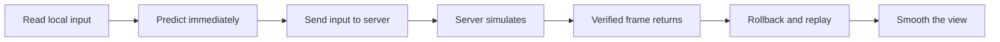

# PurrDiction

PurrDiction is PurrNet's client-side prediction addon. It lets the controlling client simulate input immediately while the server runs the authoritative simulation. When a verified server frame arrives, the client restores the verified state, replays newer inputs, and smooths any visible correction.



Use PurrDiction for gameplay where waiting for a round trip would feel bad: player movement, vehicles, projectiles, physics interactions, combat state, or other tick-based systems.

## Do you need PurrDiction?

If all you want is movement that responds instantly for the player who controls it, you may not need prediction. PurrNet has two ways to get there:

| | [Owner auth](../terminology/owner-auth.md) on `NetworkTransform` / `NetworkRigidbody` | PurrDiction with `PredictedIfOwned` |
| --- | --- | --- |
| Feels instant for the owner | Yes. The owner moves the object locally and sends the result. | Yes. The owner simulates its input immediately. |
| Who decides the result | The owning client. The server applies the owner's pose without checking it against your game rules. | The server. Clients send input; the server simulates and the owner is corrected to the verified state. |
| Cheating and desync | A modified client can move anywhere. Collisions between two owner-driven objects are resolved differently on each machine. | Movement is validated on the server (see `SanitizeInput`). Interactions are reconciled against one authoritative simulation. |
| What it costs you | Add the component, enable **Owner Auth** (on by default), and move the object in your own script. Works with your existing RPCs and SyncVars. | Write a `PredictedIdentity` with separate input and state, keep simulation code replay-safe, and use predicted equivalents instead of RPCs, SyncVars, `NetworkTransform` and `Instantiate` inside predicted gameplay. |

Start with owner auth when the game is cooperative or casual, the owner's movement is the only thing that has to feel instant, and trusting that client is acceptable. See [Network Transform](../plug-n-play-components/network-transform.md) and [Network Rigidbody](../plug-n-play-components/network-rigidbody.md).

Choose PurrDiction when the server must stay authoritative over movement (competitive play, anti-cheat), or when locally controlled objects must interact correctly with physics, projectiles or other players. For owner-only prediction, use the `PredictedIfOwned` [prediction policy](prediction-policies.md): the owner predicts, and everyone else follows verified server state.

PurrDiction is an architectural choice, not a component you add to one object. Predicted gameplay doesn't use RPCs or sync types; read [Don't mix regular networking into predicted gameplay](best-practices.md#dont-mix-regular-networking-into-predicted-gameplay) before converting part of an existing RPC/SyncVar game.

## The mental model

Every predicted object has two layers:

* **Simulation** runs at the network tick rate. Inputs and state are saved so PurrDiction can roll back and replay them.
* **View** runs once per rendered frame. It turns corrected simulation state into smooth visuals without changing gameplay.

The server remains authoritative. Clients send input, not trusted gameplay state.

## Start here

1. [Install and configure PurrDiction](installation.md).
2. Read the [architecture overview](overview.md).
3. Choose a [prediction policy](prediction-policies.md) for each kind of object.
4. Implement a [Predicted Identity](predicted-identities.md), or begin with a [built-in component](built-in-components/README.md).
5. Review [input handling](input-handling.md), [state handling](state-handling.md), and the [execution flow](flow.md) before building more complex interactions.


Prediction can hide latency; it cannot remove server authority or make nondeterministic gameplay safe. Code that affects gameplay must be replay-safe, and one-shot presentation effects must not fire again during catch-up or rollback.

