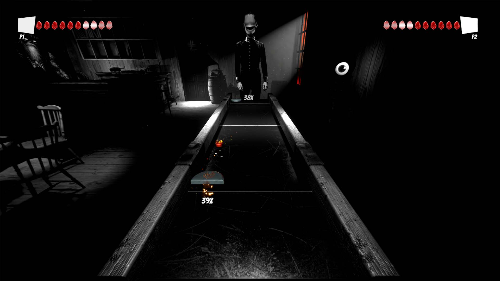
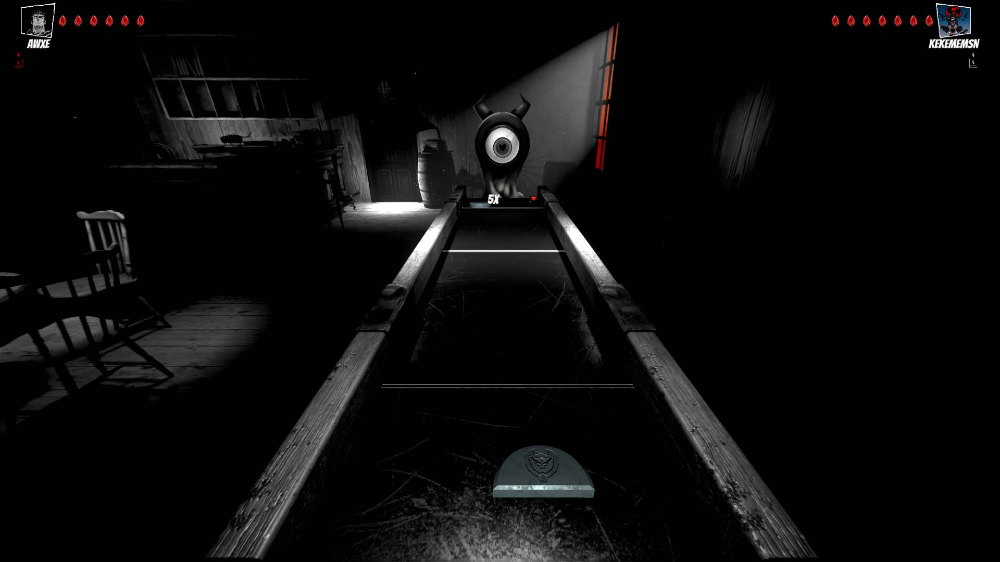

# 🏒 Puck'n Hell

Puck'n Hell is a dark arcade air hockey game by **OVERCLOCK**, set in a cafe in limbo. Face strange opponents across the table or challenge a friend to an online 1v1 match through Steam.

[Check it out on Steam!](https://store.steampowered.com/app/4676260/Puckn_Hell/)



## Physics-driven duels

Paddle hits, wall rebounds and glancing deflections are driven by physics. Keep a rally going to increase the damage of your next goal, and outplay the opponent across the table.

<figure><figcaption>Keep the rally alive to raise the stakes of the next goal.</figcaption></figure>

## Built with PurrNet

The developer uses **PurrNet** and [**PurrDiction**](../client-side-prediction/) for multiplayer networking and prediction, with [**PurrVoice**](../tools/purrvoice-voice-chat/) integrated for voice chat.

<figure><figcaption>Challenge friends in online 1v1 matches through Steam.</figcaption></figure>
