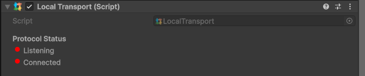

# Local Transport

The local transport mimics how the Network acts, but never actually sends any data over a network. This is great if you want your game to work in single player or local co-op while still using networking code and components.

You still start it like a host: start both the server and the client (`StartHost`, or auto-start flags that include both). Starting only the client leaves it waiting to connect forever, and nothing networked (including PurrDiction's `PredictionManager`) spawns. The default auto-start flags start only the client in a client build, so set the server flags too when a build uses the local transport.

The player will still act as a [host](../../../terminology/host.md).

<figure><figcaption>
Example of local transport component
</figcaption></figure>
