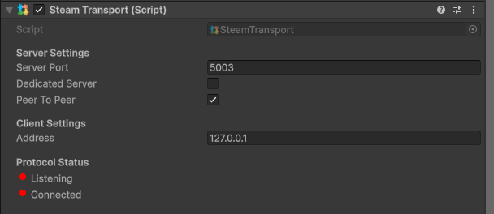

# Steam Transport

The Steam Transport comes with PurrNet by default, but it needs a Steam library to talk to Steam: [Steamworks.NET](https://github.com/rlabrecque/Steamworks.NET) (by rlabrecque), or Facepunch.Steamworks through the PurrNet-Facepunch package. Until one of them is installed, the component shows as disabled.

[Read the comprehensive guide by Judsin here.](../../guides/steam-setup/connect-with-steam.md)

### Installation

The easiest way is to open **Tools / PurrNet / PurrNet Packages** and hit install on **Steamworks.NET**. One click and you're done.

You can also add the `SteamTransport` component to your `NetworkManager` and click **Add SteamWorks.NET to Package Manager** in its inspector.

If you'd rather pull it in by hand, open Unity's Package Manager, click **Add package from git URL**, and paste:

```
https://github.com/rlabrecque/Steamworks.NET.git?path=/com.rlabrecque.steamworks.net#2024.8.0
```

Steam only runs on standalone builds (Windows, Linux and macOS). On any other build target the transport stays disabled.

#### Using Facepunch.Steamworks instead

If your project uses [Facepunch.Steamworks](https://github.com/Facepunch/Facepunch.Steamworks), install the **Facepunch** package from **Tools / PurrNet / PurrNet Packages**, or click **Add Facepunch.Steamworks to Package Manager** in the `SteamTransport` inspector. By hand, the git URL is:

```
https://github.com/PurrNet/PurrNet-Facepunch.git?path=/Assets/PurrNetFacepunch#release
```

This package already includes Facepunch.Steamworks, so remove any copy you added to the project yourself first. Facepunch support needs PurrNet 1.26 or newer.

Pick one library, not both. Steamworks.NET and Facepunch.Steamworks declare the same types, and the project won't compile with both installed.

### Parameters

* Server Port - The port to connect through
* Dedicated server - Whether you're connecting as/to a [Steam Game Server](https://partner.steamgames.com/doc/features/multiplayer/game_servers)
* Peer To Peer - Whether you want clients connecting directly using P2P
* Address - The address to connect to. In case of P2P, this is the CSteamID

### Steam isn't networking!

It's highly important that devs understand that networking isn't Steam and Steam isn't networking. A Steam "Lobby" isn't network related either. Purely a way for Steam users to share meta data through Steam (usernames, Steam ID, chat, etc.)

<figure><figcaption><p>Example of steam transport component</p></figcaption></figure>
